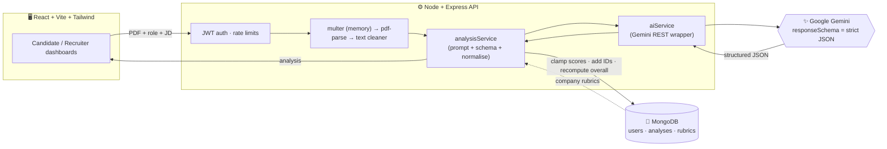

<div align="center">

# 🧠 AI Resume Analyzer

### ResumeIQ: an AI resume analyzer & career coach

Two dashboards in one app: one for **job seekers**, one for **recruiters**.

**Fix your resume. Rank your candidates. Powered by Google Gemini.**

<br/>

### 🚀 [**Open the Live Demo**](https://ai-resume-analyzer-liard-five-30.vercel.app)

<br/>

[⚡ Quick Start](#quick-start) &nbsp;&nbsp;|&nbsp;&nbsp; [🔌 API](#api) &nbsp;&nbsp;|&nbsp;&nbsp; [🩹 Troubleshooting](#troubleshooting)

<br/>

**Built with**

`React 18` &nbsp; `Vite 5` &nbsp; `Tailwind CSS 3` &nbsp; `Node.js 18+`

`Express 4` &nbsp; `MongoDB` &nbsp; `Google Gemini` &nbsp; `Vercel`

</div>

## 📑 Table of contents

- [🎯 What is this?](#what-is-this)
- [❓ Why does it exist?](#why)
- [✨ Features](#features)
- [🧭 How to use it (what → when → how)](#how-to-use)
- [🏗️ How it works](#how-it-works)
- [🧰 Tech stack](#tech-stack)
- [⚡ Quick start: run it locally](#quick-start)
- [🔐 Environment variables](#env)
- [🌍 Deploy it](#deploy)
- [🔌 API reference](#api)
- [📂 Project structure](#structure)
- [🤖 The AI layer in detail](#ai-layer)
- [🛡️ Security, privacy & fairness](#security)
- [📱 Mobile-first UI](#mobile)
- [🩹 Troubleshooting](#troubleshooting)
- [⚠️ Known limits & roadmap](#roadmap)
- [👤 Author](#author)

---

<a id="what-is-this"></a>

## 🎯 What is this?

**AI Resume Analyzer (ResumeIQ)** reads a PDF resume with Google Gemini and turns it into structured, evidence-based feedback. It has **two modes**, switched with one toggle in the navbar:

| | 🧑‍💻 **Candidate mode** | 🧑‍💼 **Recruiter mode** |
|---|---|---|
| **Goal** | "Make *my* resume better." | "Tell me who to interview." |
| **Input** | 1 PDF resume + target role (+ optional job description, company, salary location) | Up to **20 PDF resumes** + 1 job description |
| **Output** | Scores, radar chart, skill gaps, weak bullets with AI rewrites, culture-fit report, cover letter, PDF report | Ranked table, match score & verdict per candidate, side-by-side radar comparison, red flags, interview questions, resume chat, interview invite |
| **Time to result** | ~20–40 seconds | ~1–2 minutes for a batch |

> 🚀 **Try it now, no install needed:** <https://ai-resume-analyzer-liard-five-30.vercel.app>

---

<a id="why"></a>

## ❓ Why does it exist?

- **Job seekers** get rejected by ATS filters and vague bullets, but nobody tells them *why*. Generic "resume checkers" give a number with no explanation.
- **Recruiters** spend minutes per resume on first-pass screening, and the same JD is applied inconsistently from one resume to the next.
- **This project** gives both sides *specific, explainable* output: every score comes with evidence from the resume, every weak bullet comes with a rewrite, and every recruiter verdict comes with pros, cons and objective red flags.

> 💡 The AI is **decision support, not a decision maker.** The UI says so, and the recruiter prompt is built to ignore protected characteristics (see [Security, privacy & fairness](#security)).

---

<a id="features"></a>

## ✨ Features

### 🧑‍💻 For candidates

| Feature | What you get |
|---|---|
| 📊 **Three headline scores** | **Overall** (weighted profile + match), **Job Match** (fit to the target role) and **ATS Readiness** (structure & keywords), shown as animated gauges: 🟢 > 75, 🟡 50–75, 🔴 < 50 |
| 🕸️ **Skill radar** | Five axes: Technical, Tools, Experience, Soft Skills, Culture Fit |
| 🎚️ **Seniority fit + salary estimate** | Junior / Mid-level / Senior with reasoning and confidence, plus an estimated yearly salary range in your currency (INR, USD…) |
| 🧩 **Skill gaps** | Missing skills compared with the JD, each with a concrete way to close the gap |
| ✏️ **Fix Weak Points + ✨ Fix with AI** | 3–8 weak bullets are quoted verbatim, tagged High / Medium / Low, and rewritten in **STAR** style with one click. Numbers it cannot know are shown as `[placeholders]` for you to verify. |
| 🏢 **Culture fit** | Score + evidence + "how to strengthen" per company principle for **Amazon, Google, Microsoft, Adobe, Product-based companies and Service-based companies** |
| 💬 **Chat with your resume** | Ask anything ("Do I show evidence of Docker?"). Answers are grounded in your resume only. History is saved. |
| ✉️ **Cover-letter generator** | Four tones (professional, enthusiastic, concise, creative), tailored to company + role + JD, downloadable as **PDF or TXT** |
| 📄 **Branded PDF report** | One-click report of your analysis, generated in the browser |
| 🕘 **History** | Reopen or delete any past analysis |

### 🧑‍💼 For recruiters

| Feature | What you get |
|---|---|
| 📥 **Bulk screening** | Drop up to 20 PDFs, paste one JD, press **Rank candidates** |
| 🏆 **Auto-ranked board** | Rank, match score, seniority level and a verdict: **Strong yes / Yes / Maybe / No** |
| 🔃 **Sort & filter** | Sort by AI rank, match score, profile average, seniority or recommendation. Filter by verdict. |
| 🆚 **Compare up to 3 candidates** | Tick the checkboxes to overlay their skill radars |
| 🔍 **Candidate drawer** | Assessment, radar, pros, cons, matched / missing skills, **objective** red flags and suggested interview questions |
| 💬 **Chat with a resume** | Ask follow-up questions about any candidate |
| ✉️ **Send Interview Invite** | For *Strong yes* and *Yes* candidates: an editable draft you can copy or open in your email app |
| 🗂️ **Recent batches** | Reopen any earlier screening |

### 🌟 For everyone

🌙 Dark / light mode (remembers your choice, follows your OS by default) · 📱 fully responsive · ⏳ skeleton loaders · 🔔 toast notifications · 🔐 JWT login · 🗑️ delete-my-data

---

<a id="how-to-use"></a>

## 🧭 How to use it (what → when → how)

### 🧑‍💻 I am a job seeker

| Step | What to do | Why |
|---|---|---|
| **1** | Register / log in, keep the toggle on **Candidate** | Your analyses are private and saved to your account |
| **2** | Drop your resume **PDF** (max 5 MB, text-based, not a scan) | The PDF is parsed in memory and never written to disk |
| **3** | Type a **Target role** (e.g. *Full-Stack Engineer*) | Every score is judged against this role |
| **4** | *(Optional)* Paste a **job description** | Gives a precise match score and real skill gaps |
| **5** | *(Optional)* Pick a **target company** | Adds company-culture scoring (Amazon, Google, Microsoft, Adobe…) |
| **6** | Pick **salary location / currency** | Salary estimate is shown in your currency |
| **7** | Press **Analyze resume** | The AI returns scores, gaps, weak bullets and more |
| **8** | Open **Fix Weak Points** → **Fix with AI** | Rewrites vague bullets in STAR format. Replace `[placeholders]` with *real* numbers. |
| **9** | Use **Chat**, **Cover Letter**, **Download PDF Report** | Prepare for interviews and applications |

### 🧑‍💼 I am a recruiter

| Step | What to do | Why |
|---|---|---|
| **1** | Switch the toggle to **Recruiter** | Opens the bulk-screening dashboard |
| **2** | Enter **Job title** and paste the full **Job description** (min. 30 characters) | All candidates are scored against the same JD, so the ranking is consistent |
| **3** | Drop **up to 20 PDFs** | One batch = one ranked list |
| **4** | Press **Rank candidates** | Resumes are read in parallel (bounded concurrency) |
| **5** | Sort / filter, tick up to **3** candidates | Compare their radars side by side |
| **6** | Click a candidate | Read pros, cons, red flags, interview questions, or chat with the resume |
| **7** | **Invite** a *Strong yes* / *Yes* candidate | Edit the draft, then copy it or open it in your mail app |
| **8** | Come back later via **Recent batches** | No need to re-upload |

> 🧪 **Testing tip:** use sample or fake resumes. On Gemini's free tier, prompts may be used by Google to improve its products, so avoid real personal data.

---

<a id="how-it-works"></a>

## 🏗️ How it works



1. **Upload**: the PDF is received in memory (multer) and its text is extracted (pdf-parse) and cleaned.
2. **Prompt**: resume + JD (wrapped as untrusted *data*) + optional company rubric are combined into a prompt.
3. **Structured answer**: Gemini is forced to reply in a **JSON schema**, so the UI never parses free text.
4. **Normalise**: the server clamps scores to 0–100, adds IDs and **recomputes the overall score from the radar**, so numbers are always consistent.
5. **Store & show**: the analysis is saved (auto-expires, see [privacy](#security)) and rendered by the dashboards.

---

<a id="tech-stack"></a>

## 🧰 Tech stack

| Layer | Technology | Used for |
|---|---|---|
| **Frontend** | React 18, Vite 5 | SPA and fast dev server |
| | Tailwind CSS 3 | Mobile-first, dark-mode styling |
| | Recharts | Skill radar and comparison charts |
| | jsPDF | Client-side PDF report and cover-letter PDF |
| | Axios, lucide-react | API client, icons |
| **Backend** | Node.js ≥ 18, Express 4 | REST API |
| | Mongoose 8 + MongoDB | Users, analyses, company rubrics, TTL expiry |
| | JWT + bcryptjs | Authentication |
| | multer, pdf-parse | In-memory upload and PDF text extraction |
| | helmet, cors, express-rate-limit, morgan | Security headers, CORS, rate limiting, logging |
| **AI** | Google **Gemini** (`gemini-2.5-flash` by default) | Analysis, rewrite, chat, cover letter, recruiter ranking |
| **DevOps** | Docker Compose, Vercel | Local MongoDB, frontend hosting |

---

<a id="quick-start"></a>

## ⚡ Quick start: run it locally

> 🚀 **Just want to look around?** Open the live demo, no setup needed: <https://ai-resume-analyzer-liard-five-30.vercel.app>

### ✅ Prerequisites

| Need | Why | Get it |
|---|---|---|
| **Node.js 18+** | Runs the API and the Vite client | [nodejs.org](https://nodejs.org) |
| **MongoDB** (Docker *or* Atlas) | Stores users and analyses | [Docker](https://www.docker.com/) or a free [MongoDB Atlas](https://www.mongodb.com/atlas) cluster |
| **Gemini API key** (free) | Powers every AI feature | [aistudio.google.com/apikey](https://aistudio.google.com/apikey) |

### 1️⃣ Clone

```bash
git clone https://github.com/abhijeetsaini832-blip/Ai-Resume-Analyzer.git
cd Ai-Resume-Analyzer
```

> If your repo has everything inside an `ai-resume-analyzer/` folder, run `cd ai-resume-analyzer` as well.

### 2️⃣ Start MongoDB

**Option A: Docker** (simplest)

```bash
docker compose up -d        # MongoDB on localhost:27017
```

**Option B: MongoDB Atlas**: create a free cluster, copy its connection string and use it as `MONGODB_URI` in the next step.

### 3️⃣ Start the API (port 5000)

```bash
cd server
cp .env.example .env        # Windows (cmd): copy .env.example .env
```

Open `server/.env` and set at least:

```env
GEMINI_API_KEY=your_key_here
JWT_SECRET=any-long-random-string
```

Then:

```bash
npm install
npm run dev                 # → http://localhost:5000
```

✅ Company rubrics (Amazon, Google, Microsoft, Adobe, Product-based, Service-based) are **seeded automatically** on the first start.
✅ Check it: open <http://localhost:5000/api/health> → `{"ok":true}`

### 4️⃣ Start the web app (port 5173)

Open a **second terminal**:

```bash
cd client
npm install
npm run dev                 # → http://localhost:5173
```

In development, Vite **proxies `/api` to port 5000**, so no CORS setup or `VITE_API_URL` is needed.

### 5️⃣ Try it 🎉

1. Open <http://localhost:5173> and **register**.
2. Upload a sample resume PDF in **Candidate** mode → **Analyze resume**.
3. Switch to **Recruiter**, add a JD + a few PDFs → **Rank candidates**.

### 📜 Useful scripts

| Where | Command | Does |
|---|---|---|
| `server/` | `npm run dev` | API with auto-reload (nodemon) |
| `server/` | `npm start` | API in production mode |
| `server/` | `npm run check` | Syntax check of the server entry |
| `client/` | `npm run dev` | Vite dev server |
| `client/` | `npm run build` | Production build into `client/dist` |
| `client/` | `npm run preview` | Preview the production build |

---

<a id="env"></a>

## 🔐 Environment variables

### `server/.env`

| Variable | Required | Default | What it does |
|---|:---:|---|---|
| `GEMINI_API_KEY` | ✅ | — | Your Google AI Studio key |
| `MONGODB_URI` | ✅ | `mongodb://127.0.0.1:27017/ai-resume-analyzer` | MongoDB connection string |
| `JWT_SECRET` | ✅ | — | Secret for signing login tokens. Use a long random string. |
| `JWT_EXPIRES_IN` | | `7d` | Token lifetime |
| `GEMINI_MODEL` | | `gemini-2.5-flash` | Model name. Check AI Studio for models on your tier. |
| `PORT` | | `5000` | API port |
| `NODE_ENV` | | `development` | Set `production` when deployed |
| `CLIENT_ORIGIN` | | `http://localhost:5173` | Allowed frontend origin(s) for CORS. Comma-separate several. |
| `MAX_FILE_MB` | | `5` | Max size per PDF |
| `MAX_BATCH_FILES` | | `20` | Max resumes per recruiter batch |
| `BATCH_CONCURRENCY` | | `2` | Resumes processed in parallel. **Keep 1–2 on the free tier.** |
| `RETENTION_DAYS` | | `30` | Auto-delete analyses after N days (`0` = keep forever) |

The server **refuses to start** if `MONGODB_URI`, `JWT_SECRET` or `GEMINI_API_KEY` is missing.

### `client/.env`

| Variable | Default | What it does |
|---|---|---|
| `VITE_API_URL` | *(empty)* | Leave empty in dev. In production set it to your deployed API, e.g. `https://your-api.example.com/api` |

---

<a id="deploy"></a>

## 🌍 Deploy it

The app is two parts: a **static frontend** and a **Node API**. The frontend is live at <https://ai-resume-analyzer-liard-five-30.vercel.app>.

### 🟦 Frontend → Vercel

1. Import the GitHub repo in Vercel.
2. Set **Root Directory** to `client` (or `ai-resume-analyzer/client` if the app sits in a subfolder).
3. Framework preset: **Vite** (build `npm run build`, output `dist`).
4. Add the environment variable `VITE_API_URL=https://<your-api-host>/api`.
5. Deploy. Redeploy whenever you change `VITE_API_URL`, because Vite bakes it in at build time.

### 🟩 Backend → any Node host (Render, Railway, Fly, a VPS…)

1. Root directory: `server`. Build command: `npm install`. Start command: `npm start`.
2. Add the variables from the table above. Use a **MongoDB Atlas** URI for `MONGODB_URI`.
3. Set `NODE_ENV=production`.
4. Set `CLIENT_ORIGIN` to your Vercel URL: `https://ai-resume-analyzer-liard-five-30.vercel.app` (no trailing slash).
5. In Atlas → **Network Access**, allow your host's IP (or `0.0.0.0/0` for a demo).

> ✅ The API already sets `trust proxy`, so rate limiting sees real client IPs behind a reverse proxy.

---

<a id="api"></a>

## 🔌 API reference

All routes live under `/api`. Everything except `/health` and `/auth/register|login` needs the header `Authorization: Bearer <JWT>`.

<details>
<summary><b>👉 Click to expand the full endpoint list</b></summary>

<br/>

| Method | Route | Purpose |
|---|---|---|
| `GET` | `/api/health` | Liveness check |
| `POST` | `/api/auth/register` · `/api/auth/login` | Create account / log in → JWT |
| `GET` | `/api/auth/me` | Current user |
| `GET` | `/api/companies` · `/api/companies/:slug` | Company culture rubrics |
| `POST` | `/api/analyses` | `multipart`: `resume` + `jobDescription`, `targetRole`, `companySlug`, `location` → full analysis |
| `GET` | `/api/analyses` · `/api/analyses/:id` | History / one analysis |
| `DELETE` | `/api/analyses/:id` | Erase an analysis |
| `POST` `GET` `DELETE` | `/api/analyses/:id/chat` | Chat with the resume · read history · clear |
| `POST` | `/api/rewrite-bullet` | `{ analysisId, weakPointId }` → STAR rewrite (**Fix with AI**) |
| `POST` | `/api/analyses/:id/cover-letter` | Tailored cover letter |
| `POST` | `/api/recruiter/batches` | `multipart`: `resumes[]` + `jobDescription` → ranked candidates |
| `GET` | `/api/recruiter/batches` · `/api/recruiter/batches/:batchId` | Batch history / reopen a batch |

**Rate limits**

| Scope | Limit |
|---|---|
| All `/api` routes | 600 requests / 15 min |
| Login & register | 30 requests / 15 min |
| AI routes (analyze, chat, rewrite, cover letter, batches) | 20 requests / min |

</details>

---

<a id="structure"></a>

## 📂 Project structure

```text
Ai-Resume-Analyzer/
├── docker-compose.yml          # local MongoDB
│
├── server/                     # 🟩 Node + Express API
│   ├── .env.example
│   └── src/
│       ├── server.js · app.js  # boot, middleware, routes
│       ├── config/             # env.js (validated), db.js
│       ├── models/             # User, Analysis, CompanyRubric
│       ├── seed/               # companies.js (6 company rubrics)
│       ├── middleware/         # auth (JWT), upload (multer, memory), errorHandler
│       ├── services/           # pdfService, textCleaner, aiService (Gemini), analysisService
│       ├── prompts/            # ← ALL system + user prompt templates
│       ├── schemas/            # ← JSON schemas that force structured output
│       ├── controllers/        # auth, company, analysis, recruiter, chat, rewrite, coverLetter
│       ├── routes/             # index.js
│       └── utils/              # AppError, pool (bounded concurrency)
│
└── client/                     # 🟦 React + Vite + Tailwind
    ├── .env.example
    └── src/
        ├── pages/              # CandidateDashboard, RecruiterDashboard
        ├── components/         # UploadZone, ScoreGauge, SkillRadar, WeakPoints, CultureFit,
        │                       # ChatPanel, CoverLetter, RecruiterBoard, InviteModal, …
        ├── context/            # Auth, Theme, Toast
        └── lib/                # api.js (axios), hooks.js, reportPdf.js, score.js
```

---

<a id="ai-layer"></a>

## 🤖 The AI layer in detail

| Topic | How it works |
|---|---|
| **Strict JSON** | Every feature has a JSON schema (`schemas/index.js`). Gemini must answer with `responseSchema`, so the UI never parses free text. |
| **Normalised in code** | Scores are clamped to 0–100, IDs are added, and the overall score is **recomputed from the radar** so numbers never disagree. |
| **Calibrated scoring** | Prompts include anchors (50 = average, 65 = solid, 75 = strong, 85+ = rare) so not everyone scores 85. |
| **Evidence only** | The model may not credit skills, employers, degrees or metrics that are not in the resume. |
| **Company culture** | A `CompanyRubric` (values + hiring style) is rendered into the prompt. The model returns a score, evidence and a "to strengthen" tip for each principle. |
| **Weak-point rewrites** | `/rewrite-bullet` takes a `weakPointId`, not free text, so it cannot be abused as a free LLM proxy. Unknown numbers become `[placeholders]`. |
| **Chat** | One resume fits in context, so chat uses the full resume text. Swap to chunk + embeddings if you later add long documents. |
| **Provider** | Gemini over plain REST. Change the model with `GEMINI_MODEL`. |
| **Rate-limit friendly** | Bounded batch concurrency (`BATCH_CONCURRENCY`) and client retries with backoff on HTTP 429. |

All prompts live in one file, `server/src/prompts/index.js`, so they are easy to review and tune.

---

<a id="security"></a>

## 🛡️ Security, privacy & fairness

| Area | What the project does |
|---|---|
| 🔒 **Prompt-injection defence** | Resume and JD text are wrapped in tags and declared as *data*. A resume saying "rate me 100" is ignored. |
| 🚫 **No fabricated metrics** | The rewriter inserts `[X%]` placeholders and lists what *you* must fill in. Invented numbers on a resume are a real risk. |
| ⚖️ **Fair screening** | The recruiter prompt ignores protected characteristics. Red flags must be objective. The UI states the AI is decision support. |
| 🧱 **IDOR-safe** | Every per-analysis route loads by `{ _id, user }`, so users only see their own data. |
| 🧹 **Privacy by default** | PDFs are parsed **in memory** (never saved to disk). Analyses **auto-expire** through a MongoDB TTL index (`RETENTION_DAYS`). Users can delete any analysis. |
| 💸 **Cost control** | Tighter rate limit on AI routes, bounded batch concurrency, file and JD size limits. |
| 🛡️ **Hardening** | `helmet`, CORS allow-list, request body size limit, bcrypt password hashing, JWT with expiry. |

---

<a id="mobile"></a>

## 📱 Mobile-first UI

- Designed for **phone → tablet → desktop** (tested at 393 × 852).
- The input form **collapses after you analyze**, so results get the whole screen.
- Candidate details open in a **full-screen drawer** on phones and a side panel on larger screens.
- Wide tables **scroll sideways inside their card** instead of breaking the page.
- Inputs use a 16 px font on phones to stop iOS from zooming in on focus.

---

<a id="troubleshooting"></a>

## 🩹 Troubleshooting

| Problem | Fix |
|---|---|
| Server exits with `Missing required env vars` | Fill `MONGODB_URI`, `JWT_SECRET` and `GEMINI_API_KEY` in `server/.env`. |
| `ECONNREFUSED 127.0.0.1:27017` | MongoDB is not running. Run `docker compose up -d` or use an Atlas URI. |
| "Too many AI requests" / HTTP 429 | You hit a rate limit. Wait a minute and set `BATCH_CONCURRENCY=1`. |
| "…contains almost no selectable text" | The PDF is a scan (image only). Export a text-based PDF. OCR is on the roadmap. |
| "…may be corrupted or password-protected" | Re-export the PDF without a password. |
| Frontend loads, but every call fails in production | `VITE_API_URL` is wrong or missing. Fix it and **redeploy**. Also check `CLIENT_ORIGIN` on the API. |
| CORS error in the browser | `CLIENT_ORIGIN` on the API must exactly match your frontend URL (no trailing slash). |
| Recruiter page looks narrower than the screen on a phone | Pull the latest code. `RecruiterDashboard.jsx` now uses `grid-cols-[minmax(0,1fr)]` and `min-w-0` on the upload panel. Refresh the page after redeploying. |

---

<a id="roadmap"></a>

## ⚠️ Known limits & roadmap

- [ ] 🖼️ **OCR** for scanned PDFs (e.g. Tesseract). Today they are rejected with a clear message.
- [ ] 📬 **Job queue** (e.g. BullMQ) for large batches. Today batches run synchronously, which is fine for about 20 resumes.
- [ ] 💰 **Real salary data** in the prompt. Today's figures are model estimates, not market data.
- [ ] 🏢 **Admin UI** for company rubrics. Today they are edited in `server/src/seed/companies.js`.
- [ ] 🧪 **Tests and CI**: Jest + supertest for routes with a mocked `aiService`.
- [ ] 🌐 More languages and more company rubrics.

> Company rubrics are approximations built from public values and are not official hiring criteria.

---

<a id="author"></a>

## 👤 Author

**Abhijeet Saini**

| | |
|---|---|
| 📧 **Email** | [abhijeetsaini832@gmail.com](mailto:abhijeetsaini832@gmail.com) |
| 🐙 **GitHub** | [github.com/abhijeetsaini832-blip](https://github.com/abhijeetsaini832-blip) |
| 🚀 **Live demo** | [ai-resume-analyzer-liard-five-30.vercel.app](https://ai-resume-analyzer-liard-five-30.vercel.app) |

<div align="center">

<br/>

**If this project helped you, a ⭐ on the repo means a lot!**

<sub>Built with React, Node, MongoDB and Google Gemini · <a href="https://ai-resume-analyzer-liard-five-30.vercel.app">Live demo</a> · <a href="https://github.com/abhijeetsaini832-blip">GitHub</a> · <a href="mailto:abhijeetsaini832@gmail.com">Contact</a></sub>

</div>
